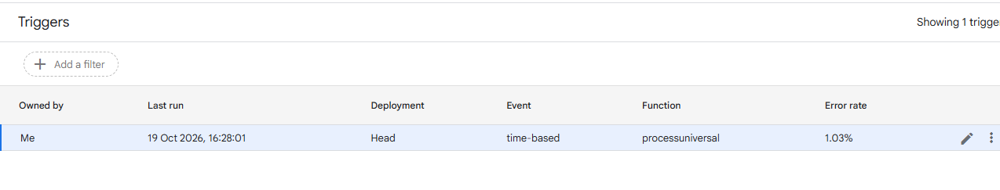

# Global Economic Risk Analysis and Automated Data Pipeline (IMF WEO) | Google Apps Script, Google Sheets, Excel

An end-to-end analytics project: IMF World Economic Outlook files are consolidated automatically by a Google Apps Script pipeline into a master Google Sheet, then analyzed in an interactive Excel dashboard covering 194 countries (2019-2025).

## Dashboard Preview

<!-- SCREENSHOT 1: final dashboard image -->


## Business Problem

A client has capital ready for global investment but is unsure which countries offer the safest and most stable economic environment. The raw economic data is scattered across files, inconsistent in format and hard to interpret, so the client cannot tell which economies are stable and which face risks such as high inflation or weak growth.

This project builds a data pipeline that collects and consolidates the incoming files without manual work, and a dashboard that shows country-level economic stability in one place.

## Dataset

- **Source:** [IMF World Economic Outlook (WEO)](https://www.imf.org/en/Publications/WEO), April 2025 edition
- **Content:** Economic indicators by country and year, 2019-2025, for 194 countries
- **Fields:** WEO Country Group Code, Country Group Name, Country Name, Subject Descriptor, Units, Scale, Year, Value
- **Indicators used (7):** inflation (average consumer prices), unemployment rate, real GDP growth (GDP, constant prices, % change), investment (% of GDP), gross national savings (% of GDP), general government net lending/borrowing (% of GDP), and GDP based on PPP, share of world total (%)
- **Note:** 2025 values are IMF projections, not actuals. Each country appears once per country group it belongs to, with identical values.
- The 13 source files used to test the pipeline are in `raw_files/`.

## Tools Used

| Stage | Tool |
|---|---|
| Data collection and storage | Google Drive, Google Sheets |
| Automated consolidation (ETL) | Google Apps Script (JavaScript), Drive API |
| Analysis and dashboard | Microsoft Excel (PivotTables, PivotCharts, AVERAGEIFS, MEDIAN, map chart) |

## Workflow

<!-- DIAGRAM: pipeline architecture -->


1. **Collect:** files are dropped into a shared Google Drive source folder, using a fixed column order.
2. **Consolidate with Apps Script:** the script runs on an hourly time-driven trigger (24 runs/day). It reads Google Sheets files directly. Excel (.xlsx) files are converted through a temporary Google Sheet, read, and the temporary copy is deleted.
3. **Append and archive:** data is appended to the master Google Sheet, the header row is written once and skipped for later files, and each processed file is moved to an archive folder. Errors are caught per file and logged, so one bad file does not stop the others.
4. **Connect:** the master sheet is published as a web link and connected to the Excel dashboard, which is refreshed on demand.
5. **Data quality checks:** found a hyperinflation outlier (Venezuela, 19,906% in 2019), duplicate rows caused by country groups, and charts that added growth rates across years with Sum.
6. **Fixes:** switched to medians for the Misery Index, used Average with single-year filters, and aligned the filters of KPI cards and charts.
7. **Dashboard:** built six KPI cards and six visuals in Excel.

<!-- SCREENSHOT 2: Apps Script trigger -->


*The live script uses the function name `processuniversal`; the copy in this repository is named `processUniversal`.*

## Metrics Methodology

| Metric | Definition | Purpose |
|---|---|---|
| **Misery Index** | Median inflation + median unemployment rate across countries, per year | Shows how hard economic conditions are for the typical country |
| **Sweet Spot** | 2025 real GDP growth minus 2025 inflation, above 3 percentage points | Flags countries that grow well without runaway prices |

- **Why medians:** one extreme value (Venezuela, 19,906% in 2019) pushed the 2019 average inflation to 102%. The median is 2.2%.
- **KPI cards (2025):** inflation, investment, savings and real GDP growth are averages for the World group. Unemployment is an average across all country-group rows, because the unemployment data is not listed under the World group. Total countries is the count of distinct country names.
- **Top 10 charts:** use the average value for 2025, sorted from highest (growth) or lowest (deficits).
- **GDP share pie:** each country's share of world GDP at PPP, rescaled so the top 5 economies add up to 100%.

## Key Findings

- **KPI snapshot (2025):** average inflation 9.15, investment 23.57% of GDP, savings 21.77% of GDP, real GDP growth 3.66% and unemployment 5.00%, across 194 countries.
- The typical country's **Misery Index** rose from 7.2 in 2019 to a peak of **12.5 in 2022**, driven by the inflation surge, and eased to **7.9 by 2025**.
- **Investment** stayed in a narrow range of about 23.5% to 24.7% of GDP across the years.
- **Guyana** is the fastest-growing economy in 2025 at about **18.7%**, followed by Palau (11.9%), Senegal (10.2%) and Macao SAR (9.6%). Most of the top 10 are small economies, so high growth reflects a small base.
- **Timor-Leste** has the largest 2025 government deficit at about **-43% of GDP**, followed by Kiribati (-14.8%) and Brunei Darussalam (-12.7%). The chart shows deficits only, not total debt.
- Among the top 5 economies by share of world GDP (PPP), rescaled to 100%: China 39%, United States 31%, India 17%, Japan 7% and Germany 6%.
- The average 2025 inflation (9.15) is much higher than the median (3.0), because a few high-inflation countries pull the average up.

## Dashboard Overview

The dashboard is a single Excel page with six KPI cards and six visuals.

1. **KPI cards:** average inflation, investment, savings, real GDP growth, unemployment and total countries.
2. **Global Economic Indicators Explorer:** investment by year, filterable by country group and indicator.
3. **Misery Index:** median inflation, median unemployment and their sum, 2019-2025.
4. **Top 10 economies by real GDP growth (2025).**
5. **Sweet Spot map:** countries where real GDP growth minus inflation is above 3 percentage points. Grey means the country does not qualify or has no data.
6. **Share of GDP (PPP) among the top 5 economies (2025).**
7. **Top 10 government deficits (% of GDP, 2025).**

## Suggested Business Actions

- Use the **Sweet Spot** countries as a starting shortlist, then research debt levels and political risk before investing.
- Treat a large deficit (such as Timor-Leste or Kiribati) as a reason to check how it is financed, not as a verdict on its own.
- Be careful with the fastest-growing economies: high growth from a small base does not mean a large or stable market.
- Compare typical conditions with medians, and use averages only when outliers are not a concern.

## Repository Structure

```
automated-data-pipeline-economic-dashboard/
├── README.md
├── architecture/          # pipeline diagram and trigger screenshot
├── dashboard_pdf/         # PDF export of the dashboard
├── dashboard_screenshot/  # dashboard screenshot
├── dashboard_xlsx/        # Excel dashboard
├── google_script/         # Apps Script (process_universal.gs)
└── raw_files/             # IMF WEO files used to test the pipeline
```

## How to Run

1. Create a Google Sheet to act as the master sheet, and open **Extensions > Apps Script** from it.
2. Paste `process_universal.gs` from `google_script/` into the project.
3. Enable the **Drive API** advanced service (**Services > + > Drive API**).
4. Create two Drive folders (source and archive) and set their IDs in `SOURCE_FOLDER_ID` and `ARCHIVE_FOLDER_ID`.
5. Add a time-driven trigger for `processUniversal` (**Triggers > Add Trigger > Time-driven > Hour timer**).
6. Drop files from `raw_files/` into the source folder, and check that the master sheet fills up.
7. Publish the master sheet to the web, open the `.xlsx` in `dashboard_xlsx/` with Excel, and update the data source link before refreshing.

## Assumptions and Limitations

- All files must follow the same column order. The script does not validate column headers across files.
- Only the first sheet of each file is read.
- If a file is copied but fails to move to the archive folder, it can be copied again on the next run.
- Averages are unweighted, so a small country counts the same as a large one.
- Unemployment is not listed under the World group, so the unemployment KPI and median use all country-group rows, while inflation uses the World group.
- 2025 values are projections, and the Sweet Spot threshold (3 percentage points) is a judgment call I defined.
- The data has no debt measure, so debt pressure is not assessed.
- The Excel dashboard is refreshed manually from the published link.

## Author

**Meenakshi Rajpurohit**
B.Tech in Computer Science Engineering, Government Engineering College, Bikaner
[imeenakshii28@gmail.com]
